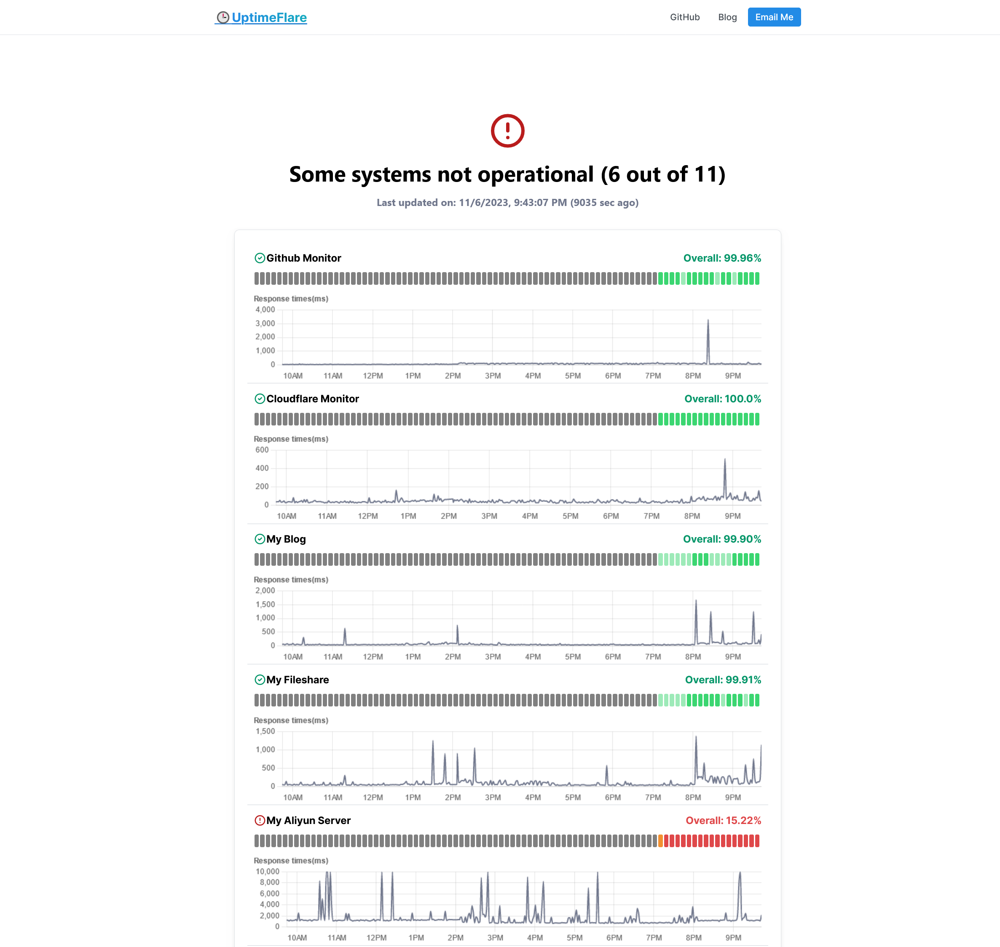

  
  

# ✔[UptimeFlare](https://github.com/lyc8503/UptimeFlare)

一个由 Cloudflare Workers 驱动的功能丰富、Serverless 且免费的 Uptime 监控及状态页面。

📢 **[[安全公告](https://github.com/lyc8503/UptimeFlare/security/advisories/GHSA-36q9-v7p3-vj6v) 2026/03/04]** 已修复一个可能导致 `uptime.config.ts` 中的监控配置和凭据暴露给客户端的漏洞 (CVE-2026-29779)。受影响的版本为 2025-09-21（自提交 `41257c6` 起）至 2026-03-04 之间的版本。**强烈建议受影响的用户升级到最新版本。**

🎉 **[更新 2026/01/03]** 我已将 UptimeFlare 从 KV 迁移到 D1 数据库，同时将 Terraform Cloudflare provider 更新到 v5 并改进了部署流程。数据结构也经过优化，解决了长期存在的性能问题。

新用户可以直接部署，现有用户可以使用简单的自动迁移流程（见下方升级文档）！部署过程中遇到任何问题，欢迎提交 issue。

## ⭐功能

- 开源，易于部署（全程无需本地工具，耗时不到 10 分钟），且完全免费
- 监控功能
  - 最多支持 50 个 1 分钟精度的检查
  - 支持指定全球 [310+ 个城市](https://www.cloudflare.com/network/) 的监控节点
  - 支持 HTTP/HTTPS/TCP 端口监控
  - 最多 90 天的 uptime 历史记录和 uptime 百分比跟踪
  - 可自定义的 HTTP(s) 请求方法、头和主体
  - 可自定义的 HTTP(s) 状态码和关键字检查
  - 支持 [100 多个通知渠道](https://github.com/caronc/apprise/wiki) 的宕机消息通知
  - 可自定义的 Webhook
  - 多语言支持 (中文/英文)
- 状态页面
  - 所有类型监控的交互式 ping（响应时间）图表
  - 定时维护提醒与事件历史页面
  - 响应式 UI，自适应PC/手机屏幕，及亮色/暗色系统主题
  - 配置选项丰富的状态页面
  - 可使用您自己的域名与 CNAME
  - 可选的密码认证（私人状态页面）
  - 用于获取实时状态数据的 JSON API

## 👀演示

我自己的状态页面（在线演示）：https://uptimeflare.pages.dev/

一些截图：

## ⚡快速入门 / 📄文档

请参阅 [Wiki](https://github.com/lyc8503/UptimeFlare/wiki)

## 🚀升级现有部署

通过 [简单的升级流程](https://github.com/lyc8503/UptimeFlare/wiki/Synchronize-updates-from-upstream) 立即获取最新功能

## ⚙️开发者文档

如需贡献新功能或进一步定制您的部署，请参阅 [此处](https://github.com/lyc8503/UptimeFlare/wiki/How-to-develop)。

## 新功能 (TODOs)

- [x] 为监控指定地区
- [x] TCP `opened` promise
- [x] 使用 apprise 支持多种通知渠道
- [x] ~~Telegram 示例~~
- [x] ~~[Bark](https://bark.day.app) 示例~~
- [x] ~~通过 Cloudflare Email Workers 发送邮件通知~~
- [x] 提供简单示例，改进文档
- [x] 通知宽限期
- [ ] SSL 证书检查
- [x] ~~自托管 Dockerfile~~
- [x] 事件历史
- [x] 改进 `checkLocationWorkerRoute` 并修复可能的 `proxy failed`
- [x] 分组
- [x] 移除旧事件
- [x] ~~已知问题~~：`fetch` 不支持非标准端口（CF 更新后已解决）
- [x] 兼容性日期更新
- [x] 定时维护
- [x] 添加开发者文档
- [x] 迁移到 Terraform Cloudflare provider 5.x 版本
- [x] Cloudflare D1 数据库
- [x] 定时维护（通过 IIFE）
- [x] 更简单的配置示例
- [x] 即将到来的维护提醒
- [x] 通用 Webhook 升级
- [x] i18n...?（也许）
- [ ] 通过代理进行 ICMP？
- [x] 添加默认 UA
- [x] 可自定义页脚
- [x] 新的顶部 Logo
- [x] 改进 CPU 时间占用
- [x] 本地部署（文档完善中）
